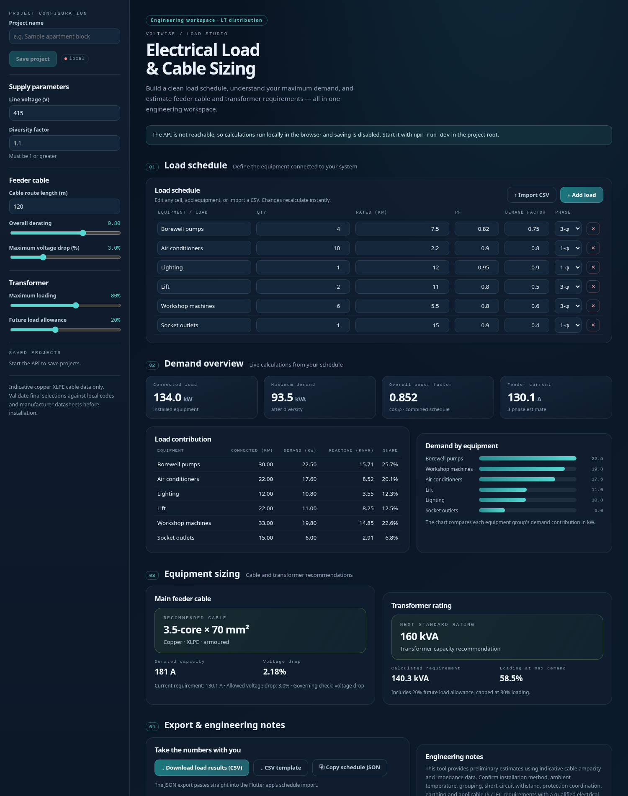

# ⚡ Voltwise — Electrical Load & Cable Sizing Estimator

A full-stack rebuild of the original Python/Streamlit estimator on the **MERN stack** (MongoDB, Express, React, Node) with a **Flutter** mobile app. Enter a load schedule and get the numbers an electrical engineer needs for an LT distribution system: **maximum demand, feeder current, main cable size and transformer rating**.



Both clients run the **same calculation engine** — the JavaScript port powers the API and the React app, and a line-for-line Dart port powers the Flutter app offline. All three are checked against golden values produced by the original Python engine.

```
packages/engine   shared JS engine (no dependencies, unit tested)
backend           Express + Mongoose REST API (MERN)
web               React + Vite single-page app (MERN)
mobile            Flutter app with a Dart port of the engine
samples           the original sample load schedule
```

## Why this shape

Load calculations and cable sizing are usually done in long, error-prone spreadsheets. The tool automates the standard workflow — enter loads → apply demand and diversity factors → size the cable for **both** current capacity and voltage drop → pick a standard transformer — and shows every step so the result can be checked.

The MERN split keeps the domain rules in one place: the API is the single source of truth for saved projects, and the same rules are available to the browser (instant preview) and to the phone (works with no network at all).

## Stack

| Layer | Technology |
| --- | --- |
| Database | MongoDB 7 via Mongoose 8 (falls back to a JSON file store when no `MONGO_URI` is set) |
| API | Node 20 · Express 4 · ES modules |
| Web | React 18 · Vite 5 · hand-rolled SVG/CSS charting (no chart library) |
| Mobile | Flutter 3.27+ · Dart 3.6+ · `http` only |
| Engine | `@voltwise/engine` — dependency-free ES module; Dart mirror in `mobile/lib/core/engine.dart` |

## Quick start — one command

Requires Node 20+ and, for the app, Flutter 3.27+.

```bash
npm install       # installs all workspaces (engine, api, web)
npm run dev:all   # API on :4000 + web app on :5173, one terminal
```

That is the whole MERN app. `npm run dev:full` adds the Flutter app as a third
process (Flutter must be on your `PATH`).

In VS Code, press **Ctrl+Shift+B** (or *Terminal → Run Task → “Run everything
(API + Web)”*) to start both servers in one panel; the other tasks cover the
Flutter app, tests, build and seeding. `api.http` holds ready-made requests for
the REST Client extension.

If you prefer separate terminals:

```bash
npm run dev        # terminal 1 — API on http://localhost:4000
npm run dev:web    # terminal 2 — web app on http://localhost:5173
```

### One port, no dev server

`npm run serve` builds the React app and serves it **from the API** on
http://localhost:4000 — so a single process gives you the UI and the API. That
is also what the Docker image does. Without a build, `http://localhost:4000/`
answers with a JSON note telling you how to get the UI, and `GET /api` lists the
endpoints.

MongoDB is optional. With `MONGO_URI` unset the API stores projects in `backend/.data/projects.json`, so the whole stack runs with no database installed. To use MongoDB, copy the env file and set the URI:

```bash
cp backend/.env.example backend/.env
# MONGO_URI=mongodb://127.0.0.1:27017/voltwise
npm run dev
```

Flutter app:

```bash
cd mobile
flutter create --platforms=android,ios --org com.voltwise --project-name voltwise_mobile .
flutter pub get
flutter run                       # Android emulator reaches the API on 10.0.2.2:4000
flutter test
```

`flutter create` is a one-time step that adds the `android/` and `ios/` folders; it does not touch `lib/`.

The mobile app always calculates locally, so it works offline; saving and loading projects needs the API.

## Scripts (from the repo root)

| Command | What it does |
| --- | --- |
| `npm run dev:all` | **API + web together** (concurrently, colour-tagged logs) |
| `npm run dev:full` | API + web + `flutter run` |
| `npm run dev` | Express API with `--watch` |
| `npm run dev:web` | Vite dev server (proxies `/api` to port 4000) |
| `npm run dev:mobile` | `flutter run` inside `mobile/` |
| `npm run test:mobile` | `flutter test` inside `mobile/` |
| `npm run build` | Production build of the React app into `web/dist` |
| `npm start` | Start the API (serves `web/dist` if it exists) |
| `npm run serve` | `build` + `start` — the whole app on one port |
| `npm test` | Engine tests (16) + API tests (9) |
| `npm run seed` | Insert the sample apartment-block project |

## API at a glance

| Method | Path | Purpose |
| --- | --- | --- |
| GET | `/api/health` | Liveness + which store is active |
| GET | `/api/reference` | Cable table, transformer ratings, default settings |
| POST | `/api/estimate` | Stateless estimate for a schedule |
| POST | `/api/import/csv` | Parse a load-schedule CSV (`text/csv` or `{ "csv": "..." }`) |
| GET | `/api/import/template` | Download a CSV template |
| GET | `/api/projects` | List saved projects |
| POST | `/api/projects` | Create a project (stores the first report) |
| GET | PUT | DELETE | `/api/projects/:id` | Read, update, remove |
| POST | `/api/projects/:id/estimate` | Recompute and store the latest report |

Full request/response examples: [docs/API.md](docs/API.md).

```bash
curl -s localhost:4000/api/estimate \
  -H 'content-type: application/json' \
  -d '{"loads":[{"name":"Pumps","quantity":4,"ratedKw":7.5,"powerFactor":0.82,"demandFactor":0.75}],
       "settings":{"voltage":415,"diversityFactor":1.15,"cableLengthM":60}}' | jq .summary
```

## The calculation model

1. **Per load** — connected kW = quantity × rated kW; demand kW = connected × demand factor; reactive kVAr = demand kW × tan(φ).
2. **Schedule** — kW and kVAr are summed *separately* and combined as kVA = √(kW² + kVAr²). kVA values with different power factors cannot be added directly, so this matters.
3. **Maximum demand** — kVA ÷ diversity factor.
4. **Feeder current** — 3-phase `I = P / (√3 · V · cos φ)`, single-phase `I = P / (V · cos φ)`.
5. **Cable** — the smallest size (and fewest parallel runs) that passes *both* derated ampacity **and** voltage drop: `Vd = √3 · I · L · (R cos φ + X sin φ)` for three phase, `2 · I · L · (…)` for single phase.
6. **Transformer** — required kVA = max demand × (1 + future margin) ÷ maximum loading, rounded up to the next standard rating.

Cable data lives in one table (`packages/engine/src/tables.js`, mirrored in `mobile/lib/core/tables.dart`): indicative 1.1 kV copper XLPE armoured cable in air at ~40 °C. Swap it for a manufacturer datasheet or your local standard.

## Testing

```bash
npm test                     # 16 engine tests + 9 API tests
cd mobile && flutter test    # 19 Dart tests, same expectations
```

`packages/engine/test/golden.json` holds values computed with the **original Python engine** before the port. The JS and Dart suites both assert against it, so the three implementations cannot drift silently.

The Dart engine can also be verified with no packages at all:

```bash
cd mobile && dart tool/verify_engine.dart
```

## Docker

```bash
docker compose up --build     # mongo + api :4000 + web :8080
```

## Project layout

```
.
├── backend/
│   ├── src/
│   │   ├── app.js               express app factory (cors, parsers, routes, errors)
│   │   ├── server.js            bootstrap: db connect, listen, graceful shutdown
│   │   ├── config/              env + mongoose connection
│   │   ├── models/Project.js    Mongoose schema (loads, settings, lastReport)
│   │   ├── repositories/        Mongoose repo + JSON file store behind one interface
│   │   ├── routes/              health, reference, estimate, import, projects
│   │   ├── services/            report assembly
│   │   └── middleware/          validation + error handler
│   ├── test/api.test.js
│   └── scripts/seed.js
├── packages/engine/
│   ├── src/{core,tables,csv,index}.js
│   └── test/{core.test.js,golden.json}
├── web/
│   └── src/{App.jsx,components,api,lib,styles.css}
├── mobile/
│   ├── lib/{core,services,state,screens,widgets}
│   ├── test/
│   └── tool/verify_engine.dart
└── samples/sample_loads.csv
```

## Engineering disclaimer

This tool provides **preliminary estimates** using indicative cable ampacity and impedance data. Confirm installation method, ambient temperature, grouping, short-circuit withstand, protection coordination and earthing, and the applicable IS / IEC requirements, with a qualified electrical engineer before using these results for construction.

## License

MIT — see [LICENSE](LICENSE).
